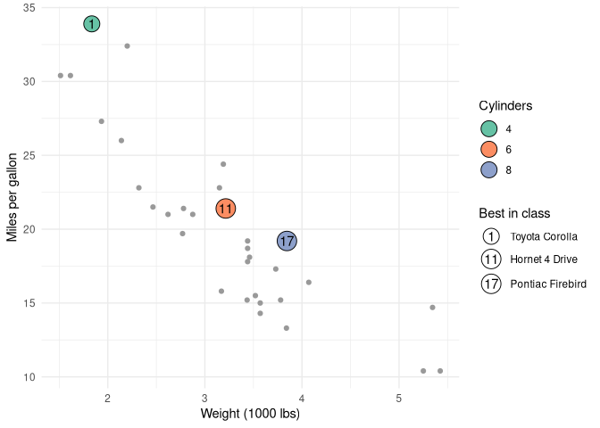

[](https://ko-fi.com/J3J8133RYV)

Many years ago I was asked to demo a new `ggplot2` extension. It was supposed to be a paid project, but it didn't work out. I had the demo half done, and as i moved to work on other things -- including not making plots regularly as part of my work -- I forgot about it. 

Then as I was doing maintenance of some other R packages, I noticed the folder on my computer. Fast-forward to now, and the v0.1.0 of this package is on it's way to CRAN.

{fig-alt="ggindex logo, source: GitHub"}

{ggindex} is a new ggplot2 extension that marks points with numbers and explains the numbers in a legend, the way a campus map lists buildings beside the plan.

That layout is common on maps and in annotated figures, but ggplot2 has no direct way to draw it -- at least that I know of. Usually, a legend key shows a symbol: a coloured dot, a line, a square. It cannot show the number written next to a point, so the reader has to match labels to descriptions by eye.

## Meet `geom_focus()`

Map `info` to the description that belongs in the legend, and `geom_focus()` does the rest: it numbers the points 1, 2, 3 in data order, draws each number in a marker, and builds a legend whose keys carry the same numbers.

```r
# install.packages("pak")
pak::pak("discindo/ggindex")

library(ggplot2)
library(ggindex)

sites <- data.frame(
  x = c(6, 7, 8, 9, 10),
  y = c(6, 9, 7, 10, 8),
  name = c("Library", "Main hall", "Sports centre", "Cafeteria", "Car park")
)

ggplot(sites, aes(x, y, info = name)) +
  geom_focus() +
  theme_minimal()
```

To choose the numbers yourself, for example a rank or a building code, map `label` as well. The legend is then sorted by `label`, so it reads in the same order as the numbers.

## Focus on a few points

Usually only a handful of points deserve a number. Map `focus` to a logical variable and only those observations get a marker; add `geom_point()` underneath to show the rest.

```r
cars <- mtcars
cars$model <- rownames(cars)
cars$rank <- rank(-cars$mpg, ties.method = "first")

ggplot(cars, aes(wt, mpg)) +
  geom_point(colour = "grey60") +
  geom_focus(aes(label = rank, focus = rank <= 5, info = model)) +
  scale_info_discrete("Most efficient") +
  labs(x = "Weight (1000 lbs)", y = "Miles per gallon")
```

See more on the package's website: [discindo.github.io/ggindex/](https://discindo.github.io/ggindex/)